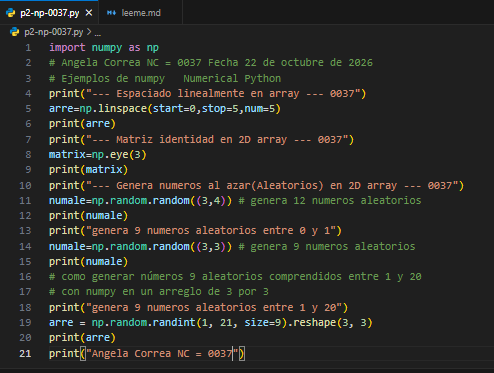
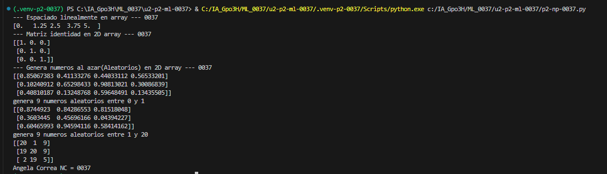

- `start=0:` Indica el valor inicial de la secuencia.
- `stop=1:` Indica el valor final de la secuencia.
- `num=5:` Indica la cantidad de números que se van a generar (5 números).

## que es np.linspace
`np.linspace()` es una función de NumPy que genera una cantidad determinada de números distribuidos uniformemente entre un valor inicial y uno final.

## El codigo 

## resultados
